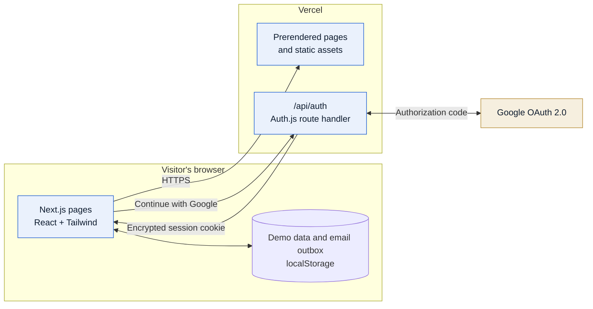
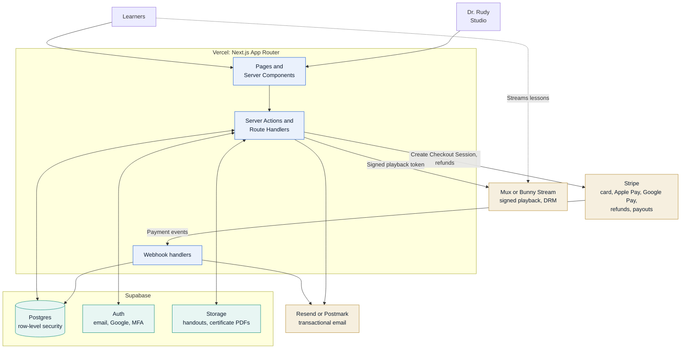
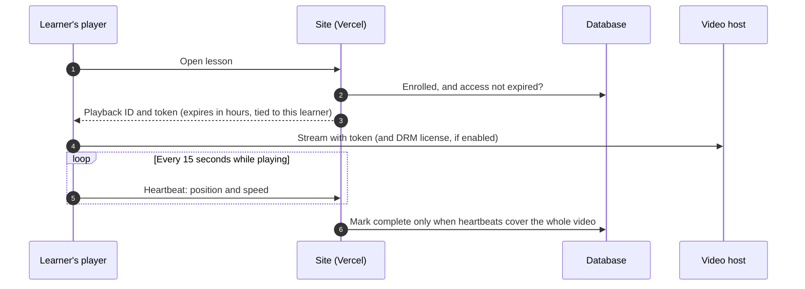

# Sonosus VR Education

Online course platform for Dr. Susanna Rudy's point-of-care ultrasound and emergency imaging curriculum,
developed at Vanderbilt University School of Nursing. Learners buy courses, watch video lessons, pass a final
exam and receive a verifiable certificate. Dr. Rudy manages courses, videos, exams, students and refunds
from an admin Studio.

| | |
| --- | --- |
| **Live preview** | https://vr-radiology-certification.vercel.app |
| **Production domains** | `sonosusvr.org` (education), `sonosusvr.com` (Virtual Response On Call) |
| **Status** | Front-end draft, about 25% complete |
| **Stack** | Next.js 16, React 19, TypeScript, Tailwind CSS 4, Auth.js, Vercel |

> **Draft mode.** Accounts, purchases, progress, emails and certificates are simulated in the browser
> (localStorage) so the full experience can be reviewed before the backend exists. Google sign-in
> is real once its credentials are configured. Nothing is charged and no email is sent.

## Contents

1. [Project status](#project-status)
2. [Architecture](#architecture)
3. [Tech stack](#tech-stack)
4. [Repository structure](#repository-structure)
5. [Getting started](#getting-started)
6. [Configuration](#configuration)
7. [Google sign-in setup](#google-sign-in-setup)
8. [Payments: cards, Apple Pay and Google Pay](#payments-cards-apple-pay-and-google-pay)
9. [Link previews](#link-previews)
10. [Video security and watch rules](#video-security-and-watch-rules)
11. [Transactional email](#transactional-email)
12. [Professional readiness review](#professional-readiness-review)
13. [Caching, cookies and performance](#caching-cookies-and-performance)
14. [Demo walkthrough](#demo-walkthrough)
15. [Domains and deployment](#domains-and-deployment)
16. [Roadmap](#roadmap)
17. [Recommended services](#recommended-services)
18. [Production checklist](#production-checklist)
19. [Credits](#credits)

## Project status

| Area | Status | Notes |
| --- | --- | --- |
| Storefront, catalog and course pages | Built | Placeholder courses, prices and lessons |
| Cart and checkout | Built | Review, payment and confirmation steps; Apple Pay, Google Pay and card; payment is simulated |
| Lesson player and paywall | Built | Access is enforced in the browser only |
| Watch rules | Built | No skipping ahead on the first viewing, any speed, completes only at the end; checked in the browser only |
| Exams and certificates | Built | Graded in the browser; certificates are pass/fail |
| Certificate verification page | Built | Checks certificates stored in the visitor's browser |
| Admin Studio | Built | Courses, students, refunds, email previews; saved in the editor's browser only |
| Google sign-in | Live | Credentials configured in Vercel |
| Transactional email | Designed | Six templates and their triggers; recorded in Studio, not yet delivered |
| Link previews | Built | Branded share cards for both domains and an iPhone app icon |
| Security headers | Built | Baseline headers on every response; full Content Security Policy pending |
| Legal pages | Drafted | Privacy, Terms, Refunds, Accessibility; attorney review pending |
| sonosusvr.com landing page | Built | "Coming soon" page for Virtual Response On Call |
| Database and server-side accounts | Not started | |
| Real payments | Not started | Stripe recommended |
| Secure video hosting | Not started | Waiting on Dr. Rudy's recordings and host decision; three sample clips are bundled |
| Custom domains | Pending | DNS not yet pointed at Vercel |

## Architecture

### Current (draft)

All pages are prerendered and served from Vercel's CDN. Course data, accounts, progress and the email
outbox live in the visitor's browser. The only server code is the Auth.js route that handles Google
sign-in.



### Target (production)

The browser no longer holds trusted data. Every purchase, watch record, exam result, certificate and email
is created on the server, and paid videos only play with short-lived signed tokens.



### Purchase flow (target)

Access is granted by the payment webhook, never by the browser.

```mermaid
sequenceDiagram
  autonumber
  participant L as Learner
  participant S as Site (Vercel)
  participant P as Stripe
  participant D as Database
  participant E as Email

  L->>S: Reviews order, continues to payment
  S->>P: Create PaymentIntent (prices from the database)
  P-->>L: Payment fields on /checkout/pay (card, Apple Pay, Google Pay)
  L->>P: Confirms in the wallet sheet, or submits the card
  P-->>S: Webhook: checkout.session.completed
  S->>D: Record order, create enrollments
  S->>E: Send receipt
  S-->>L: Confirmation page; courses unlocked in My Courses
```

### Lesson playback (target)



## Tech stack

| Layer | Choice | Notes |
| --- | --- | --- |
| Framework | Next.js 16 (App Router, Cache Components) | Read `AGENTS.md`: this Next.js version differs from older documentation |
| UI | React 19, Tailwind CSS 4, Motion, Lucide icons | Light theme with navy brand surfaces |
| Language | TypeScript (strict) | |
| State (draft) | Zustand with localStorage persistence | Replaced by the database in the next phase |
| Authentication | Auth.js 5 with Google, stateless JWT sessions | No database required yet |
| Email templates | Plain TypeScript, HTML and text output | `src/lib/email/templates.ts`; works with any email service |
| Graphics | WebGL starfield and ultrasound scanner | Pauses when off screen; respects reduced motion |
| Hosting | Vercel | Automatic deploy on every push to `main` |

## Repository structure

```text
src/
  app/
    (site)/            Storefront: home, catalog, course pages, checkout (review, pay, success), dashboard, legal
    (auth)/            Sign in, sign up, Google sign-in completion
    (focus)/           Lesson player, exam, certificate (distraction-free layout)
    (oncall)/on-call/  Landing page served on sonosusvr.com
    studio/            Admin Studio: overview, courses, students, emails, settings
    api/auth/          Auth.js route handler (Google sign-in)
    opengraph-image    Link-preview card; icon1/icon2 are the tab icons, apple-icon the iPhone icon
  auth.ts              Auth.js configuration
  components/
    learn/             Lesson player; protected-video.tsx holds the watch rules
    studio/            Studio pages, including emails.tsx (template previews and outbox)
    ...                marketing, course, certificate, layout, ui
  lib/
    email/templates.ts Every automatic email: content, triggers, HTML and text rendering
    brand-mark.tsx     The logo mark, defined once; every logo on the site, icons and previews draws from it
    share-card.tsx     Design for link-preview cards and the app icons
    site.ts            Brand name, domains, provenance wording, demo flag
    seed/              Placeholder course catalog and demo records
    store/             Draft data stores (catalog, session, cart)
    types.ts           Domain model; maps one-to-one onto future database tables
    image-credits.ts   Licenses for every third-party image and video
assets/
  fonts/               Plus Jakarta Sans for the preview cards (SIL Open Font License)
Sonosus VR Logo Options/  Logo concepts, the current logo exported as files, and where it appears
public/
  images/              Course art, photos, headshots, brand marks
  videos/              Sample ultrasound clips (CC BY 2.0)
```

## Getting started

Requirements: Node.js 20 or newer.

```bash
npm install
npm run dev      # http://localhost:3000 (in Codespaces, open the forwarded port 3000)
npm run build    # production build check
npm run lint
```

## Configuration

Set these in **Vercel > Project > Settings > Environment Variables**, then redeploy. Sign-in buttons are
decided when the site is built, so a redeploy is required after any change. For local development, put them
in `.env.local` (never commit it).

| Variable | Required | Purpose |
| --- | --- | --- |
| `NEXT_PUBLIC_DEMO_MODE` | No | Set to `false` once the backend is live; hides draft tools and notes |
| `AUTH_SECRET` | For Google sign-in | Encrypts session cookies. Generate with `openssl rand -base64 32` |
| `AUTH_GOOGLE_ID` | For Google sign-in | OAuth client ID from Google Cloud |
| `AUTH_GOOGLE_SECRET` | For Google sign-in | OAuth client secret from Google Cloud |
| `SITE_URL` | No | Absolute address used in link previews. Defaults to the live Vercel production domain |
| `ADMIN_EMAILS` | No | Comma-separated emails that open the Studio, for example Dr. Rudy's |
| `AUTH_TRUST_HOST` | Outside Vercel only | Set to `true` when self-hosting or running `next start` locally |

The "Continue with Google" button appears only when the three Google variables are set.

## Google sign-in setup

Google sign-in works today without a database: the signed-in user is kept in an encrypted, httpOnly cookie
for 30 days, and the site restores the account from it on every visit. A Google account and an email
account with the same address are treated as the same learner. Sign in with Apple was considered and left
out, because it needs a paid Apple Developer membership ($99 per year) and a key renewed every 6 months.

1. In [Google Cloud Console](https://console.cloud.google.com/), project `sonosus-vr-education`, open
   **Google Auth Platform**. Branding, audience (published) and the web client already exist.
2. Under **Clients > Sonosus VR website > Authorized redirect URIs**, keep one entry per address the site is
   served from:
   - `https://vr-radiology-certification.vercel.app/api/auth/callback/google`
   - `https://sonosusvr.org/api/auth/callback/google` (add when the domain is connected)
   - `http://localhost:3000/api/auth/callback/google` (local development)
3. `AUTH_GOOGLE_ID`, `AUTH_GOOGLE_SECRET`, `AUTH_SECRET` and `ADMIN_EMAILS` are set in Vercel.

## Payments: cards, Apple Pay and Google Pay

### Checkout steps

Buying always takes deliberate steps, so nobody is charged by a stray click:

| Step | Page | What happens |
| --- | --- | --- |
| 1. Review | `/checkout` | Items, promo code and the name for certificates. "Continue to payment" charges nothing. |
| 2. Payment | `/checkout/pay` | Apple Pay, Google Pay or a card form, plus "Back to your order". Wallet buttons open the wallet's own confirmation sheet; the card form has to be filled in and submitted. |
| 3. Confirmation | `/checkout/success` | Order details, payment method and a link to start learning; the receipt email goes out. |

"Buy it now" on a course page adds the course and opens step 1. In the draft, step 2 stands in for Stripe:
the wallet sheet is simulated, any valid test card works (for example `4242 4242 4242 4242` with any future
date), and nothing is charged. The draft turns off browser card autofill so no one types in a real card.

### Which wallet buttons appear

Both buttons appear on every device that can use them:

| Wallet | Works on | Hidden on |
| --- | --- | --- |
| Apple Pay | Safari on iPhone, iPad and Mac; other browsers by scanning a code with an iPhone on iOS 18 or later | Android phones. Through Stripe, desktop Chrome and Edge show it on Macs only for now, so Windows computers may not see it at launch |
| Google Pay | Chrome, Safari, Edge, Firefox and other major browsers, on desktop and mobile | Nowhere |

A learner who hasn't set up a wallet yet is walked through signing in or adding a card when they tap it.

### Going live with Stripe

Yes, this is the same flow customers get with Stripe: the review step stays as it is, and the payment step
hosts Stripe's own fields.

1. Create the Stripe account in the business's name, finish identity and bank verification, and turn on
   **Apple Pay** and **Google Pay** under **Settings > Payment methods**.
2. On `/checkout/pay`, replace the draft buttons and card form with Stripe's **Express Checkout Element**
   (wallets) and **Payment Element** (card). Set `paymentMethods: { applePay: "always", googlePay: "always" }`
   on the Express Checkout Element. Without `"always"`, Stripe hides a wallet when it guesses the learner won't
   use it, and Apple Pay in desktop Chrome and Google Pay in Firefox don't appear at all.
3. Register every domain that shows the buttons (`sonosusvr.org` and the vercel.app preview) under
   **Settings > Payment method domains**, in live mode before launch. Stripe handles Apple's merchant
   validation, so no Apple Merchant ID is needed.
4. Add `/api/checkout` (creates a PaymentIntent from the cart on the server, with the learner ID in
   metadata; prices always come from the database, never the browser) and `/api/stripe/webhook` (verifies the
   signature, then records orders, enrollments and the receipt email). Process each event ID once, because
   Stripe can deliver the same event more than once.
5. Stripe returns the learner to `/checkout/success`, which shows the order once the webhook has recorded it.
6. Refunds from the Studio call Stripe's refund API; access is removed when the `charge.refunded` webhook
   arrives, not before.
7. Turn on **Stripe Tax** or confirm with an accountant whether online courses are taxable in each state
   where learners buy.

Stripe's hosted Checkout page is a simpler alternative (redirect to `checkout.stripe.com`), but Stripe then
decides when to show each wallet, so Apple Pay and Google Pay would not appear everywhere.

`next.config.ts` already allows the browser payment feature for Stripe's frames
(`Permissions-Policy: payment=(self "https://js.stripe.com")`).

## Link previews

When a link to the site is shared in Messages, email, Slack, LinkedIn or social media, the preview shows a
branded card: the Sonosus mark and name on navy, the course tagline, Dr. Rudy's name and the domain.
`sonosusvr.com` gets its own "Virtual Response On Call" card, and iPhones get a matching home-screen icon.

| File | What it makes |
| --- | --- |
| `src/app/opengraph-image.tsx` | Preview card for every page of the education site |
| `src/app/(oncall)/on-call/opengraph-image.tsx` | Preview card for sonosusvr.com |
| `src/app/apple-icon.tsx` | 180 by 180 app icon |
| `src/lib/share-card.tsx` | Shared design for all three; fonts are in `assets/fonts` (SIL Open Font License) |

The cards are drawn at build time from code, so changing the wording or swapping in the final logo is a
one-file edit. Preview links must be absolute: on Vercel they use the live production domain automatically
(the vercel.app address until `sonosusvr.org` is connected). Set `SITE_URL` to override it.

Apps cache previews, so a link shared before a change keeps its old preview for a while. To check a new one,
paste the link into [opengraph.xyz](https://www.opengraph.xyz) or share it with `?v=2` added.

## Video security and watch rules

### What is built (browser side)

`src/components/learn/protected-video.tsx` applies these rules the first time a learner watches a lesson:

| Rule | Behavior |
| --- | --- |
| No skipping ahead | Seeking past the furthest point already watched snaps back, with a short notice. Rewinding always works. |
| Any speed | Learners can use the player's speed menu (for example 1.5x or 2x) at any time. |
| Completion at the true end | A lesson completes only when playback reaches the last frame after continuous viewing, at any speed. The manual "Complete" button is replaced by "Finish the video to continue". |
| Resume | The furthest point watched is saved every few seconds and when the learner pauses or leaves, so they pick up where they stopped. |
| Review mode | Once a lesson is complete, all the rules lift so learners can scrub freely to review. |
| Name watermark | The learner's name and email float faintly over the video and move every 15 seconds. It does not block screen recording; it makes any recording or leaked copy show whose account it came from, which discourages sharing and identifies the account to remove. Full screen wraps the whole frame, so the watermark stays visible (on iPhone the system player takes over full screen and hides it). |
| Download and casting off | No download button, right-click menu, picture-in-picture or casting, which would bypass the watermark. |

These rules attach to the standard media element interface, so they keep working with Mux Player
(`<mux-player>`) or a Bunny Stream player built on it. YouTube and Vimeo links remain for quick testing only,
and the rules do not apply to them.

### What the browser cannot do on its own

Nothing that runs in the browser can be fully protected from someone determined, because they control the
browser. Blocking developer tools is not attempted: it is easy to bypass and breaks accessibility tools.
Real protection comes from the server and the video host:

1. **No public video files.** Lessons stream from the video host as HLS. The `/videos` folder in this
   repository holds only openly licensed samples.
2. **Signed, short-lived playback.** The site issues a token only after checking enrollment and expiry.
   It expires within hours and is tied to the learner, so a copied link stops working. Mux calls these
   signed playback IDs; Bunny Stream uses embed and CDN token authentication.
3. **Domain and referrer locks** so the player works only on `sonosusvr.org`.
4. **DRM (optional, recommended for paid courses).** Widevine, FairPlay and PlayReady encrypt the stream and,
   on most browsers, blank the picture in screen-capture tools. Mux charges about $100 per month plus a small
   per-license fee; Bunny's MediaCage DRM is priced similarly. Safari and iOS need an Apple FairPlay
   deployment package.
5. **Server-checked watch time.** The player sends a heartbeat every 15 seconds (position and speed).
   The server marks a lesson complete only when the heartbeats cover the whole video without jumps,
   which also produces the attendance record accreditors expect.
6. **Rate and session limits.** Flag accounts that stream from many devices or locations at once.

## Transactional email

Every automatic email is defined in `src/lib/email/templates.ts` and previewed in **Studio > Emails**, which
also lists every email the draft "sent" in that browser. The same templates will run on the server.

| Email | Sent when | Production trigger |
| --- | --- | --- |
| Welcome | A new account is created (email or Google) | Auth provider's user-created hook |
| Purchase receipt | Checkout succeeds; one email per checkout, listing every course, payment method and order ID | Stripe `checkout.session.completed` |
| Refund and access removed | An order is refunded; access to that course ends at the same time | Stripe `charge.refunded` |
| Access granted | Staff add a course to a learner's account (comps, group seats) | Studio server action |
| Access removed | Staff remove a course without a refund, or a payment is disputed | Studio action, or Stripe `charge.dispute.created` |
| Course passed and certificate | The learner passes the final exam and the certificate is issued | Server-side exam grading |

Rules the templates already follow: pass/fail only (no scores), a plain-text version of every email, the
learner's name escaped, absolute links, the refund policy in the receipt and the verification link in the
certificate email.

Worth adding later: an access-expiring reminder 30 days before the end of access, a "second attempt
available" note after a failed exam, and password reset (handled by the auth provider). Course announcements
and newsletters are marketing, so they need opt-in, an unsubscribe link and a postal address, and should be
sent from a separate stream so they cannot hurt receipt delivery.

### Sending setup

1. Create a [Resend](https://resend.com) or [Postmark](https://postmarkapp.com) account and add the sending
   domain, for example `mail.sonosusvr.org`.
2. Add the SPF, DKIM and DMARC records they provide at GoDaddy. Start DMARC at `p=none` with reports, then
   tighten it to `quarantine`.
3. Send from `Sonosus VR Education <no-reply@mail.sonosusvr.org>` with `Reply-To` set to the support address,
   so replies reach a person.
4. Send from webhook handlers and server actions only, keyed by the event or order ID so retries never
   send twice. Log each send (template, recipient, provider message ID) for support questions.

## Professional readiness review

What learners, employers and accreditors expect from a professional continuing-education site, and where this
project stands.

| Expectation | Status | Next step |
| --- | --- | --- |
| Faculty credentials and bio | Built | Confirm details with Dr. Rudy |
| Learning objectives on every course | Built | Replace placeholder objectives with real ones |
| Disclosure of relevant financial relationships | Missing | Required by accreditors; add a disclosure block to each course page and the certificate flow |
| Accreditation statement and contact hours | Placeholder | Depends on the accreditation route (see Recommended services) |
| Post-course evaluation | Missing | Required by most accreditors before the certificate is released; add a short survey after the exam |
| Certificate with verification | Built | Server-issued PDF and shared verification record |
| Transcript of completed courses and hours | Partial | Add a downloadable CE transcript to My Learning for license renewals |
| Secure exams | Browser only | Server grading, hidden answer key, attempt limits in the database |
| Watch-time and attendance records | Browser only | Server heartbeats (see Video security) |
| Content review date and references | Missing | Show "Content reviewed {date}" and references on each course |
| Medical disclaimer | Built | Footer and Terms |
| De-identified images and video | Process | Confirm every clip and image is free of patient identifiers |
| Privacy, Terms, Refunds, Accessibility | Drafted | Attorney review |
| Captions and transcripts | Missing | Auto-captions from the video host, then a human pass |
| Receipts for employer reimbursement | Built (email) | Stripe receipts and invoices; add invoice download for teams |
| Group and institutional purchasing | Partial | Teams page and form exist; seat management and invoicing to build |
| Support channel | Partial | Dedicated support address and response-time promise |
| Admin security | Missing | MFA for Studio accounts, audit log of refunds and access changes |
| Security headers and HTTPS | Built | Full Content Security Policy with nonces |
| Search appearance | Partial | Sitemap and robots exist; add `Course` structured data and share images per course |
| Monitoring | Missing | Error tracking and uptime alerts |

## Caching, cookies and performance

**Conclusion: no extra caching layer is needed now.** The site is fast because it is mostly static, and adding
Redis, a service worker or a separate CDN would add cost and failure points without a visible benefit.

- **Pages:** prerendered at build time and served from Vercel's CDN (live responses show `x-vercel-cache: HIT`).
  Partial prerendering streams only the small signed-in parts.
- **Images and fonts:** images are already compressed (about 1.2 MB for the whole site), served and cached
  by the CDN. Fonts are self-hosted through `next/font`.
- **When the database arrives:** cache only public catalog data with Next's `'use cache'` and
  `cacheTag('catalog')`, and call `revalidateTag('catalog')` when the Studio publishes a change. Never cache
  learner data (progress, orders, exams), and send video tokens and account responses with
  `Cache-Control: private, no-store`.
- **Video:** adaptive streaming from the video host, not MP4 files from this site.
- **Cookies:** only essential cookies today: the Auth.js session (30 days) and short-lived sign-in checks,
  plus browser storage for the draft. With no analytics or advertising cookies, no consent banner is needed.
  If analytics are added, a cookieless tool (Vercel Web Analytics or Plausible) keeps it that way; Google
  Analytics would need a consent banner for visitors from the EU and UK. The Privacy Policy already describes
  essential cookies.
- **Already in place:** WebGL scenes pause off screen and respect reduced motion; baseline security headers
  (`X-Content-Type-Options`, `Referrer-Policy`, `X-Frame-Options`, `Permissions-Policy`) on every response;
  Vercel adds HSTS.

## Demo walkthrough

- **Studio login:** "Continue with Google" with an account listed in `ADMIN_EMAILS`, or the draft login
  `susanna@sonosusvr.org` with any password.
- **Draft tools** (bottom of the Studio sidebar): preview the site as a sample student, or reset all demo data.
- **Checkout:** "Buy it now" opens the review step; "Continue to payment" opens the payment step. Tap Apple Pay or Google Pay to see the confirmation sheet, or use "Use a test card".
- **Promo code:** `RUDY10` (10% off).
- **Watch rules:** enroll in Lung & Pleural Ultrasound and open "The bat sign and the pleural line" (a
  10-second sample). Try to skip ahead, change the speed, then let it finish.
- **Emails:** sign up, buy a course or pass an exam, then open **Studio > Emails** in the same browser.
- **Refunds:** **Studio > Students**, open a learner, then **Refund** next to an order.
- **Verify page:** try `SVR-DEMO-1038`, or the ID on any certificate you earn.
- In a lesson, "Draft tool: mark all lessons complete" unlocks the exam quickly.

## Domains and deployment

Pushing to `main` deploys automatically. One Vercel project serves both domains; add each under
**Project > Settings > Domains** and create the DNS records Vercel shows at GoDaddy.

| Domain | Serves | How |
| --- | --- | --- |
| `sonosusvr.org` | Sonosus VR Education (this site). Set as primary. | Default routes |
| `sonosusvr.com` | Sonosus VR: Virtual Response On Call | Host rewrite of `/` to `/on-call` in `next.config.ts` |

## Roadmap

| Phase | Scope | Depends on |
| --- | --- | --- |
| 1. Accounts and database | Supabase project, schema from `lib/types.ts`, row-level security, email and Google sign-in, admin MFA, move the Studio to server actions | Nothing |
| 2. Payments | Stripe Checkout with Apple Pay and Google Pay, webhook-created enrollments, refunds, Stripe Tax, payouts | Phase 1, Stripe account |
| 3. Video | Host decision (Mux or Bunny), Studio uploads, signed playback, DRM decision, server watch heartbeats, captions | Phase 1, recordings |
| 4. Exams and certificates | Server grading, attempt limits in the database, evaluation survey, PDF certificates, shared verification | Phase 1 |
| 5. Email | Connect the existing templates to Resend or Postmark from webhooks; domain authentication | Phases 1 and 2, domain |
| 6. Content and launch | Real catalog and exams, DNS cutover, demo mode off, monitoring, Vercel Pro, private repository | All above |

## Recommended services

| Need | Recommendation | Why | Alternatives | Cost |
| --- | --- | --- | --- | --- |
| Hosting | Vercel Pro | Built for Next.js; zero-config deploys | Netlify, Render | $20 per month. The free Hobby plan does not allow commercial use. |
| Database and auth | Supabase | Postgres, auth (Google, MFA) and file storage in one service | Neon with Auth.js, Clerk for auth only | Free to start; Pro $25 per month |
| Payments | Stripe Checkout | Hosted, PCI-compliant checkout with Apple Pay and Google Pay; refunds and payouts built in | Lemon Squeezy or Paddle as merchant of record, which handle sales tax at a higher fee | About 2.9% + 30 cents per card sale; Stripe Tax adds about 0.5% |
| Video | Mux | Signed playback, optional DRM, automatic captions, works with the watch rules | Bunny Stream (lowest cost, token auth, MediaCage DRM), Cloudflare Stream | Usage-based; DRM about $100 per month extra |
| Email | Resend or Postmark | Simple APIs; Postmark is known for receipt deliverability | SendGrid, Amazon SES | Free tiers cover launch volume |
| Certificates | Server-rendered PDF | Full control of design and verification | Accredible or Certifier (hosted credentials and badges) | Included |
| Monitoring and analytics | Sentry, Vercel Web Analytics | Error alerts and cookieless traffic stats | Plausible, PostHog | Free tiers to start |

**Other routes to weigh:**

- **Buy instead of build:** Teachable, Thinkific, Kajabi or LearnWorlds can sell video courses with quizzes
  and certificates in days. The trade-off is less control over branding, verification and the Studio, plus
  monthly fees and transaction cuts.
- **Continuing education credit:** becoming an ANCC accredited provider takes the longest. A faster route is
  joint providership with an existing accredited provider, or AANP approval per activity. Physician
  assistants need AAPA Category 1 credit.
- **Virtual Response On Call (sonosusvr.com):** patient video visits require HIPAA-compliant tools that sign
  a business associate agreement, such as Doxy.me, Zoom for Healthcare or SimplePractice. Stripe can take
  payments, but no patient information should be stored in it.

## Production checklist

Work through these in order of the headings. Items marked **(Dr. Rudy)** need her decision or signature.

### Business, legal and rights

- [ ] Business entity, EIN and business bank account for payouts **(Dr. Rudy)**
- [ ] Written permission from Vanderbilt University to use its name and "V" mark, or remove them
- [ ] Confirm Dr. Rudy owns the rights to sell her recorded lessons (university intellectual-property policy) **(Dr. Rudy)**
- [ ] Attorney review of the Privacy Policy, Terms of Service and Refund Policy, including Tennessee as governing law
- [ ] Decide public contact details: a dedicated support address, which email to publish, and whether to list a phone number **(Dr. Rudy)**
- [ ] Sales tax decision for online courses (Stripe Tax or an accountant)
- [ ] Business insurance that covers online education (professional and cyber liability)

### Accreditation and content

- [ ] Choose the continuing-education route (ANCC provider, joint providership, AANP or AAPA approval) **(Dr. Rudy)**
- [ ] Certificate wording, accreditation statement and contact hours that follow from it
- [ ] Financial relationship disclosures for every course and faculty member
- [ ] Post-course evaluation survey, required before the certificate where the accreditor asks for it
- [ ] Records retained for as long as the accreditor requires (ANCC asks for six years)
- [ ] Final course list, descriptions, objectives, prices, lessons, handouts and exam questions **(Dr. Rudy)**
- [ ] Confirm every image and clip is de-identified (no patient names, dates of birth or record numbers burned in)
- [ ] Captions for every lesson, checked by a person
- [ ] Signature image for certificates and a final logo **(Dr. Rudy)**. See `Sonosus VR Logo Options/README.md` for what to send; the new mark goes in `src/lib/brand-mark.tsx`
- [ ] Replace stock and Commons imagery with Dr. Rudy's own where possible; keep attributions for the rest
- [ ] Confirm bio details on the About page, including licensure in 48 states

### Accounts and vendors

- [ ] Vercel Pro (required before taking payments)
- [ ] Supabase project with daily backups and point-in-time recovery
- [ ] Stripe account verified, Apple Pay and Google Pay turned on
- [ ] Video host account (Mux or Bunny) and DRM decision
- [ ] Email service (Resend or Postmark)
- [ ] Every vendor account owned by the business email, protected with two-factor sign-in, and recorded in a shared password manager

### Domains and DNS

- [ ] Connect `sonosusvr.org` (primary) and `sonosusvr.com` in Vercel; add the records at GoDaddy
- [ ] Redirect `www` to the bare domain; confirm HTTPS certificates are issued
- [ ] Set `SITE_URL=https://sonosusvr.org` in Vercel so previews never point at sonosusvr.com
- [ ] Email records: SPF, DKIM and DMARC for the sending domain
- [ ] Lock both domains at GoDaddy and turn on auto-renew

### Authentication

- [ ] Add `https://sonosusvr.org/api/auth/callback/google` to the Google client
- [ ] Move accounts to Supabase Auth (or add a database adapter) and require MFA for admin accounts
- [ ] Rotate `AUTH_SECRET` if it has ever been shared

### Backend and data

- [ ] Database schema from `src/lib/types.ts` with row-level security on every table
- [ ] Studio actions moved to server actions that check the admin role on the server
- [ ] Protect pages and APIs on the server (not only in the browser)
- [ ] Audit log for refunds, access changes and exam resets
- [ ] Account deletion and data export on request

### Payments

- [ ] Stripe Express Checkout Element (`applePay` and `googlePay` set to `"always"`) and Payment Element on `/checkout/pay`
- [ ] `/api/checkout` and a signature-verified `/api/stripe/webhook`, processing each event once
- [ ] Enrollments and receipts created only by the webhook
- [ ] Refunds from the Studio through Stripe; access removed on `charge.refunded`; disputes handled
- [ ] Payment method domains registered for `sonosusvr.org` and the vercel.app address
- [ ] Test in Stripe's sandbox with cards, Apple Pay and Google Pay, then switch to live keys

### Video

- [ ] Upload lessons to the video host from the Studio; remove the sample clips from `public/videos`
- [ ] Signed playback tokens issued by the server after an enrollment check
- [ ] Player domain lock; DRM if chosen (with the FairPlay package for Apple devices)
- [ ] Server watch heartbeats; lesson completion decided by the server

### Exams and certificates

- [ ] Questions and answers stored on the server; grading on the server; attempts limited in the database
- [ ] Certificates issued on the server as PDFs, with a shared public verification record
- [ ] CE transcript download for learners

### Email

- [ ] Connect `src/lib/email/templates.ts` to the email service from webhooks and server actions
- [ ] Send a test of every template to Gmail, Outlook and iCloud; check spam placement
- [ ] Separate, opt-in stream for announcements and newsletters, with unsubscribe

### Security

- [ ] Make the GitHub repository private before real exam questions or paid content are added
- [ ] Branch protection on `main`, Dependabot alerts and secret scanning
- [ ] Content Security Policy with nonces (after Stripe and the video player are integrated)
- [ ] Rate limits on sign-in, sign-up and checkout (Vercel Firewall), and bot protection on sign-up (Cloudflare Turnstile)
- [ ] No secrets in the repository; production variables only in Vercel

### Privacy and accessibility

- [ ] Update the Privacy Policy to name Stripe, the video host and the email service
- [ ] Keep analytics cookieless, or add a consent banner
- [ ] Accessibility review to WCAG 2.1 AA (keyboard, screen reader, contrast, captions)

### Quality, monitoring and launch

- [ ] Cross-browser pass: Safari on iPhone and Mac, Chrome on Android and desktop, Edge, Firefox
- [ ] Full journey test on production: sign up, pay, watch, fail and pass the exam, certificate, verify, refund
- [ ] Error tracking (Sentry) and uptime alerts
- [ ] `Course` structured data, and per-course preview cards if wanted
- [ ] Check link previews for both domains after the DNS cutover (opengraph.xyz, iMessage, LinkedIn)
- [ ] Set `NEXT_PUBLIC_DEMO_MODE=false` and remove demo seed data
- [ ] Support process: who answers, response time, refund decisions
- [ ] After launch: review refunds, failed payments, email bounces and error alerts weekly

## Credits

Photos are from Pexels, and imaging and video clips are from Wikimedia Commons. Every item's license and
attribution is listed in `src/lib/image-credits.ts` and on the site at `/legal/image-credits`.

Developed by Steven Gobran for Dr. Susanna Rudy, DNP.
