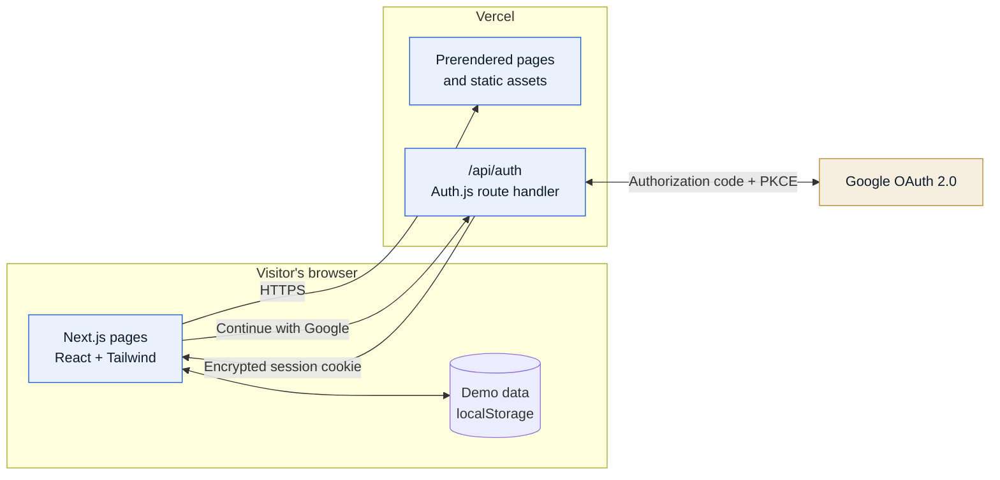
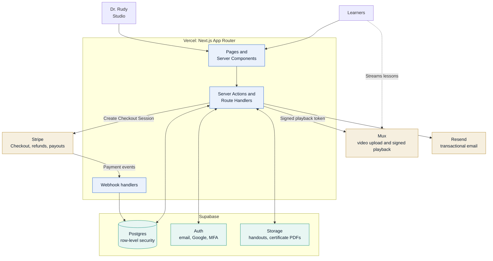
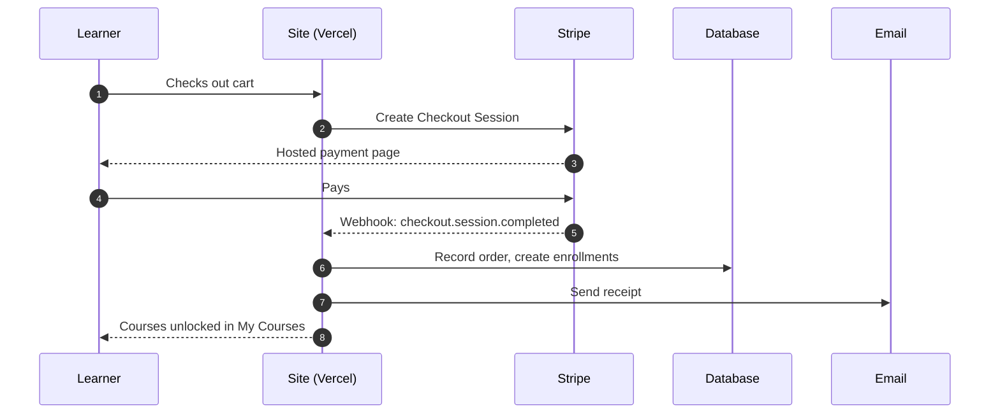

# Sonosus VR Education

Online course platform for Dr. Susanna Rudy's point-of-care ultrasound and emergency imaging curriculum,
developed at Vanderbilt University School of Nursing. Learners buy courses, watch video lessons, pass a final
exam and receive a verifiable certificate. Dr. Rudy manages courses, videos, exams and students from an
admin Studio.

| | |
| --- | --- |
| **Live preview** | https://vr-radiology-certification.vercel.app |
| **Production domains** | `sonosusvr.org` (education), `sonosusvr.com` (Virtual Response On Call) |
| **Status** | Front-end draft, about 25% complete |
| **Stack** | Next.js 16, React 19, TypeScript, Tailwind CSS 4, Auth.js, Vercel |

> **Draft mode.** Accounts, purchases, progress and certificates are simulated in the browser
> (localStorage) so the full experience can be reviewed before the backend exists. Google sign-in is real
> once its credentials are configured. Nothing is charged.

## Contents

1. [Project status](#project-status)
2. [Architecture](#architecture)
3. [Tech stack](#tech-stack)
4. [Repository structure](#repository-structure)
5. [Getting started](#getting-started)
6. [Configuration](#configuration)
7. [Google sign-in setup](#google-sign-in-setup)
8. [Demo walkthrough](#demo-walkthrough)
9. [Domains and deployment](#domains-and-deployment)
10. [What is still missing](#what-is-still-missing)
11. [What is next](#what-is-next)
12. [Recommended services](#recommended-services)
13. [Notes to close out before launch](#notes-to-close-out-before-launch)
14. [Credits](#credits)

## Project status

| Area | Status | Notes |
| --- | --- | --- |
| Storefront, catalog and course pages | Built | Placeholder courses, prices and lessons |
| Cart and checkout | Built | Payment is simulated |
| Lesson player and paywall | Built | Access is enforced in the browser only |
| Exams and certificates | Built | Graded in the browser; certificates are pass/fail |
| Certificate verification page | Built | Checks certificates stored in the visitor's browser |
| Admin Studio | Built | Edits are saved in the editor's browser only |
| Google sign-in | Built | Needs Google OAuth credentials (see below) |
| Legal pages | Drafted | Privacy, Terms, Refunds, Accessibility; attorney review pending |
| sonosusvr.com landing page | Built | "Coming soon" page for Virtual Response On Call |
| Database and server-side accounts | Not started | |
| Payments | Not started | |
| Secure video hosting | Not started | Three sample clips are bundled |
| Transactional email | Not started | |
| Custom domains | Pending | DNS not yet pointed at Vercel |

## Architecture

### Current (draft)

All pages are prerendered and served by Vercel. Course data, accounts and progress live in the visitor's
browser. The only server code is the Auth.js route that handles Google sign-in.



### Target (production)

The browser no longer holds trusted data. Every purchase, exam result and certificate is created on the
server, and paid videos are only playable with short-lived signed tokens.



### Purchase flow (target)

Access is granted by the payment webhook, never by the browser.



## Tech stack

| Layer | Choice | Notes |
| --- | --- | --- |
| Framework | Next.js 16 (App Router, Cache Components) | Read `AGENTS.md`: this Next.js version differs from older documentation |
| UI | React 19, Tailwind CSS 4, Motion, Lucide icons | Light theme with navy brand surfaces |
| Language | TypeScript (strict) | |
| State (draft) | Zustand with localStorage persistence | Replaced by the database in the next phase |
| Authentication | Auth.js 5 with Google, stateless JWT sessions | No database required yet |
| Graphics | WebGL starfield and ultrasound scanner | Pauses when off screen; respects reduced motion |
| Hosting | Vercel | Automatic deploy on every push to `main` |

## Repository structure

```text
src/
  app/
    (site)/            Storefront: home, catalog, course pages, checkout, dashboard, legal
    (auth)/            Sign in, sign up, Google sign-in completion
    (focus)/           Lesson player, exam, certificate (distraction-free layout)
    (oncall)/on-call/  Landing page served on sonosusvr.com
    studio/            Admin Studio: overview, courses, students, settings
    api/auth/          Auth.js route handler (Google sign-in)
  auth.ts              Auth.js configuration
  components/          UI by area: marketing, course, learn, studio, certificate, layout, ui
  lib/
    site.ts            Brand name, domains, provenance wording, demo flag
    seed/              Placeholder course catalog and demo records
    store/             Draft data stores (catalog, session, cart)
    types.ts           Domain model; maps one-to-one onto future database tables
    image-credits.ts   Licenses for every third-party image and video
public/
  images/              Course art, photos, headshots, brand marks
  videos/              Sample ultrasound clips (CC BY 2.0)
```

## Getting started

Requirements: Node.js 20 or newer.

```bash
npm install
npm run dev      # http://localhost:3000 (in Codespaces, open the forwarded port 3000)
npm run build    # production build check
npm run lint
```

## Configuration

Set these in **Vercel > Project > Settings > Environment Variables**, then redeploy. For local development,
put them in `.env.local` (never commit it).

| Variable | Required | Purpose |
| --- | --- | --- |
| `NEXT_PUBLIC_DEMO_MODE` | No | Set to `false` once the backend is live; hides draft tools and notes |
| `AUTH_SECRET` | For Google sign-in | Encrypts session cookies. Generate with `openssl rand -base64 32` |
| `AUTH_GOOGLE_ID` | For Google sign-in | OAuth client ID from Google Cloud |
| `AUTH_GOOGLE_SECRET` | For Google sign-in | OAuth client secret from Google Cloud |
| `ADMIN_EMAILS` | No | Comma-separated Google emails that open the Studio, for example Dr. Rudy's |
| `AUTH_TRUST_HOST` | Outside Vercel only | Set to `true` when self-hosting or running `next start` locally |

The "Continue with Google" button appears only when the three Google variables are set.

## Google sign-in setup

Google sign-in works today without a database: the signed-in user is kept in an encrypted, httpOnly cookie
for 30 days, and the site restores the account from it on every visit.

1. Open [Google Cloud Console](https://console.cloud.google.com/) and create a project named `Sonosus VR Education`.
2. Go to **APIs & Services > OAuth consent screen**. Choose **External**, enter the app name, a support
   email and the privacy policy and terms URLs (`/legal/privacy`, `/legal/terms`). The default scopes
   (`openid`, `email`, `profile`) are enough.
3. Go to **Credentials > Create credentials > OAuth client ID**, type **Web application**.
4. Under **Authorized redirect URIs**, add one entry per address the site is served from:
   - `https://vr-radiology-certification.vercel.app/api/auth/callback/google`
   - `https://sonosusvr.org/api/auth/callback/google` (after the domain is connected)
   - `http://localhost:3000/api/auth/callback/google` (local development)
5. Copy the client ID and secret into Vercel as `AUTH_GOOGLE_ID` and `AUTH_GOOGLE_SECRET`, add
   `AUTH_SECRET` and, optionally, `ADMIN_EMAILS`, then redeploy.
6. While the consent screen is in **Testing**, only listed test users can sign in. Select
   **Publish app** to open sign-in to everyone; basic profile scopes do not require Google review.

## Demo walkthrough

- **Draft tools** (footer, phone menu and Studio sidebar): sign in as a sample student, open the Studio as
  Dr. Rudy, or reset all demo data.
- **Studio login:** `susanna@sonosusvr.org` with any password.
- **Promo code:** `RUDY10` (10% off).
- **Verify page:** try `SVR-DEMO-1038`, or the ID on any certificate you earn.
- In a lesson, "Draft tool: mark all lessons complete" unlocks the exam quickly.

## Domains and deployment

Pushing to `main` deploys automatically. One Vercel project serves both domains; add each under
**Project > Settings > Domains** and create the DNS records Vercel shows at GoDaddy.

| Domain | Serves | How |
| --- | --- | --- |
| `sonosusvr.org` | Sonosus VR Education (this site). Set as primary. | Default routes |
| `sonosusvr.com` | Sonosus VR: Virtual Response On Call | Host rewrite of `/` to `/on-call` in `next.config.ts` |

## What is still missing

- **Accounts and data:** server-side user accounts, roles and a database. All records live in each visitor's
  browser today.
- **Payments:** real checkout, receipts, refunds, sales tax and payouts.
- **Video:** secure hosting and upload for Dr. Rudy's lesson recordings, with captions.
- **Server-side exams:** questions and answers are currently shipped to the browser.
- **Certificates:** server-generated PDFs and a public verification record shared across visitors.
- **Email:** welcome, receipt, password reset, certificate and course announcement emails.
- **Real content:** course list, descriptions, lessons, prices, exam questions, handouts and signature.
- **Launch work:** custom domains, analytics, error monitoring, final legal review and a full accessibility pass.

## What is next

| Phase | Scope | Depends on |
| --- | --- | --- |
| 1. Accounts and database | Supabase project, schema from `lib/types.ts`, row-level security, email and Google sign-in, admin MFA, move the Studio to server actions | Nothing |
| 2. Payments | Stripe Checkout, webhook-created enrollments, refunds, Stripe Tax, payouts to Dr. Rudy's bank | Phase 1, Stripe account |
| 3. Video | Mux direct uploads from the Studio, signed playback, auto-generated captions | Phase 1, recordings |
| 4. Exams and certificates | Server-side grading, attempt limits enforced in the database, PDF certificates, shared verification | Phase 1 |
| 5. Email | Resend templates for every transactional message, newsletter opt-in | Phase 1, domain |
| 6. Content and launch | Load the real catalog, DNS cutover, demo mode off, analytics and monitoring, Vercel Pro | All above |

## Recommended services

| Need | Recommendation | Why | Alternatives | Cost |
| --- | --- | --- | --- | --- |
| Hosting | Vercel Pro | Built for Next.js; zero-config deploys | Netlify, Render | $20 per month. The free Hobby plan does not allow commercial use. |
| Database and auth | Supabase | Postgres, auth (including Google) and file storage in one service | Neon with Auth.js, Firebase, Clerk for auth only | Free to start; Pro $25 per month |
| Payments | Stripe Checkout | Hosted, PCI-compliant checkout; refunds and payouts built in | Lemon Squeezy or Paddle as merchant of record, which handle sales tax for you at a higher fee | About 2.9% + 30 cents per sale; Stripe Tax adds about 0.5% |
| Video | Mux | Signed URLs stop link sharing; automatic captions; simple uploads | Bunny Stream (lowest cost), Cloudflare Stream, Vimeo | Usage-based; a few dollars a month at launch |
| Email | Resend | Simple API and React email templates | Postmark, SendGrid | Free tier covers launch volume |
| Certificates | Server-rendered PDF | Full control of design and verification | Accredible or Certifier (hosted credentials and digital badges) | Included |
| Monitoring and analytics | Sentry, Vercel Analytics | Error alerts and privacy-friendly traffic stats | Plausible, PostHog | Free tiers to start |

**Other routes to weigh:**

- **Buy instead of build:** Teachable, Thinkific, Kajabi or LearnWorlds can sell video courses with quizzes
  and certificates in days. The trade-off is less control over branding, verification and the Studio, plus
  monthly fees and transaction cuts.
- **Continuing education credit:** becoming an ANCC accredited provider takes the longest. A faster route is
  joint providership with an existing accredited provider, or AANP approval per activity. Physician
  assistants need AAPA Category 1 credit.
- **Virtual Response On Call (sonosusvr.com):** patient video visits require HIPAA-compliant tools that sign
  a business associate agreement, such as Doxy.me, Zoom for Healthcare or SimplePractice. Stripe can take
  payments, but no patient information should be stored in it.

## Notes to close out before launch

- [ ] Written permission from Vanderbilt University to use its name and "V" mark, or remove them
- [ ] Decide on continuing education accreditation and the certificate wording that follows from it
- [ ] Attorney review of the Privacy Policy, Terms of Service and Refund Policy, including Tennessee as governing law
- [ ] Confirm Dr. Rudy owns the rights to sell her recorded lessons (university intellectual-property policy)
- [ ] Confirm public contact details: a dedicated support address, which email to publish, and whether to list a phone number or use a contact form only
- [ ] Confirm bio details on the About page, including licensure in 48 states and years of experience
- [ ] Collect a signature image for certificates and, if wanted, a final logo
- [ ] Replace stock and Commons imagery with Dr. Rudy's own where possible; keep attributions for the rest
- [ ] Connect `sonosusvr.org` and `sonosusvr.com` in Vercel and GoDaddy
- [ ] Publish the Google OAuth consent screen and add production redirect URIs
- [ ] Upgrade to Vercel Pro before taking payments
- [ ] Set `NEXT_PUBLIC_DEMO_MODE=false` and remove demo seed data
- [ ] Caption every lesson and complete an accessibility review

## Credits

Photos are from Pexels, and imaging and video clips are from Wikimedia Commons. Every item's license and
attribution is listed in `src/lib/image-credits.ts` and on the site at `/legal/image-credits`.

Developed by Steven Gobran for Dr. Susanna Rudy, DNP.
